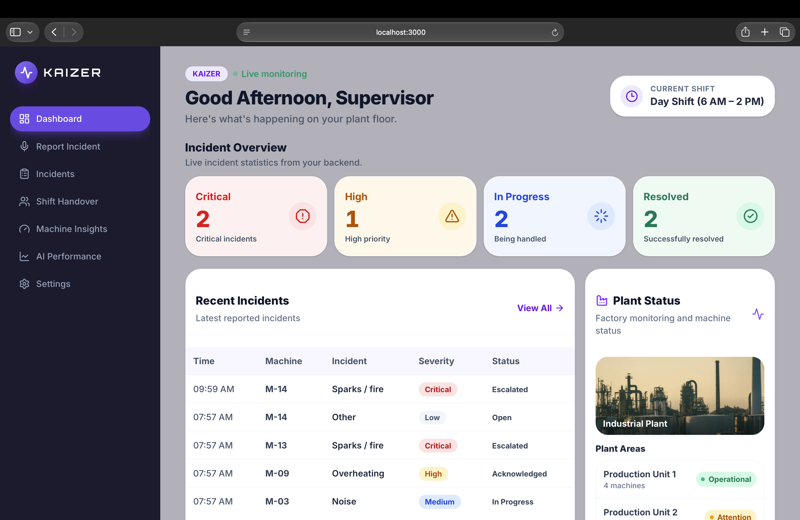
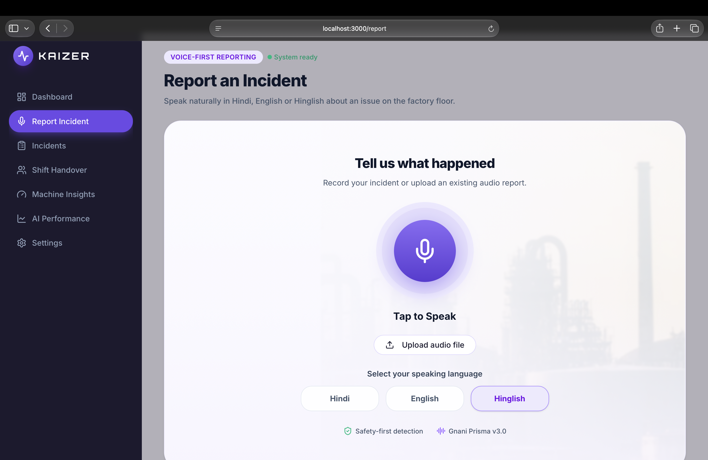
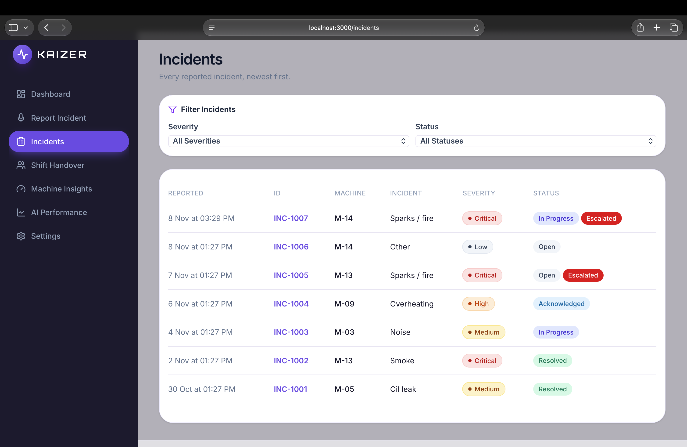
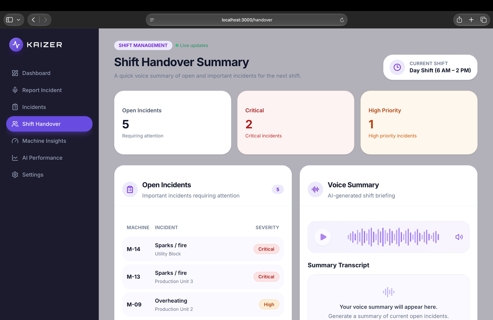
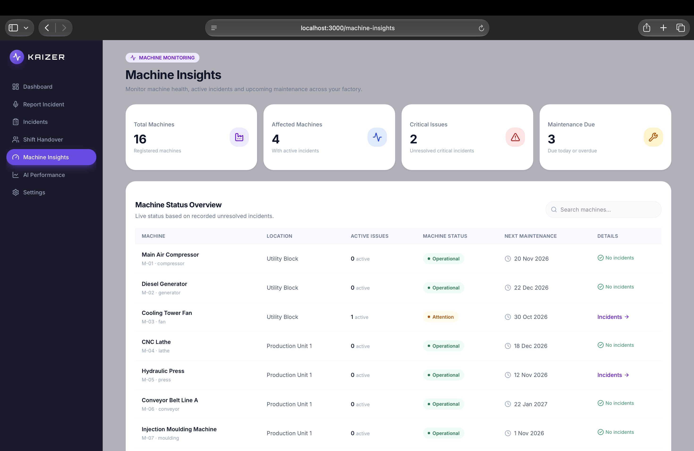
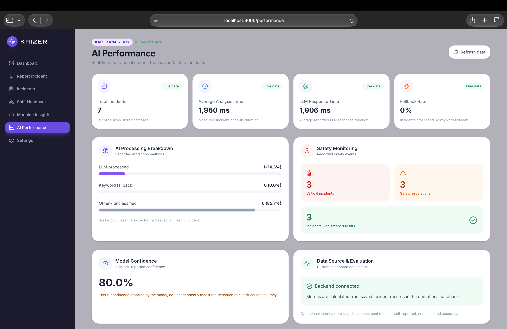

KAIZER

Making Industrial Safety Smarter with AI

Don’t just hear the danger. Outsmart it. Act on it.

An AI-powered, voice-first industrial safety and incident management platform that transforms factory-floor conversations into structured incidents, intelligent investigations, and actionable insights.

Built for the Gnani AI Great Indian AI Internship Challenge.

The Problem

Imagine a factory worker noticing smoke coming from Machine M-40. He reports it over a walkie-talkie, and everyone hears the message.

But what happens next?

* Was the incident officially recorded?
* Who is responsible for investigating it?
* Was the machine actually inspected?
* Will the next shift know about it?
* What if the same problem occurs tomorrow?

Traditional communication tools are designed to deliver messages, not manage the complete lifecycle of an industrial safety incident.

KAIZER bridges this gap between reporting an incident and ensuring it is investigated, tracked, and addressed.

Our Solution

KAIZER allows factory workers to report incidents naturally through voice in Hindi, English, or Hinglish.

It combines Voice AI, Agentic AI, and deterministic safety rules to transform voice reports into structured incidents and intelligent investigations.

How It Works

1. Voice Reporting: Workers describe incidents naturally using their voice.
2. Speech Recognition: Gnani AI Prisma converts speech into text.
3. Incident Extraction: Gemini processes the transcription and generates structured incident records.
4. Confirm-Back: KAIZER asks voice-based clarification questions when information is ambiguous.
5. Safety Detection: Deterministic rules identify critical hazards and trigger simulated alerts.
6. Duplicate Detection: Identifies potential duplicate incident reports.
7. AI Investigation: An investigation agent checks machine history, maintenance schedules, and open tickets.
8. SOP Retrieval: RAG retrieves relevant safety procedures.
9. Actionable Insights: Supervisors receive investigation findings and recommendations.
10. Voice Responses: Gnani AI Timbre generates acknowledgements and shift-handover summaries.

Application Preview

KAIZER Dashboard & Features

<table>
<tr>
<td width="50%" align="center">

Supervisor Dashboard

Real-time incident monitoring and safety overview.

</td>
<td width="50%" align="center">

Voice Incident Reporting

Multilingual incident reporting through voice.

</td>
</tr>
<tr>
<td width="50%" align="center">

Incident Management

Structured incident records, severity, and status.

</td>
<td width="50%" align="center">

Machine Insights

Machine health, maintenance, and active issues.

</td>
</tr>
<tr>
<td width="50%" align="center">

Shift Handover

Incident summaries and voice-based briefings.

</td>
<td width="50%" align="center">

AI Performance & Analytics

Incident processing metrics and safety analytics.

</td>
</tr>
</table>

Technology Stack

Component	Technologies
Frontend	Next.js 16, React.js, TypeScript, Tailwind CSS
Backend	Python, FastAPI
Database	SQLite, SQLAlchemy
Speech-to-Text	Gnani AI Prisma v3.0
Text-to-Speech	Gnani AI Timbre v2.5
LLM	Google Gemini
AI Architecture	Agentic AI, RAG
Safety Engine	Python, YAML-based deterministic rules
Infrastructure	Docker, Docker Compose

Team & Contributions

KAIZER was developed through two primary engineering workstreams.

Ansh Singh

Voice AI & Speech Intelligence

* Audio capture and voice input processing.
* Gnani AI Prisma integration (Speech-to-Text).
* Voice understanding and structured incident extraction.
* Ambiguity detection and confirm-back conversations.
* Gnani AI Timbre integration (Text-to-Speech).
* Voice pipeline and incident workflow integration.
* Hinglish voice testing and evaluation.
* Demo video production.

Riya katiyar

Backend Engineering & Application Intelligence

* FastAPI backend and REST API development.
* Database design and management for machines, incidents, tickets, and event logs.
* Agentic investigation workflows.
* RAG implementation for SOP search and retrieval.
* Duplicate incident detection and deterministic safety rules.
* Frontend integration and application workflows.
* Docker integration and end-to-end system testing.

Important Note

All machine records, incident histories, maintenance schedules, and test datasets are synthetic.

Safety alerts are simulated using predefined deterministic rules. KAIZER is a demonstration project and is not connected to real industrial alarm systems.

Don’t just hear the danger.

Outsmart it. Act on it. Eliminate it.

Your factory. Your people. Your safety.

ONE INTELLIGENT FORCE. KAIZER.

